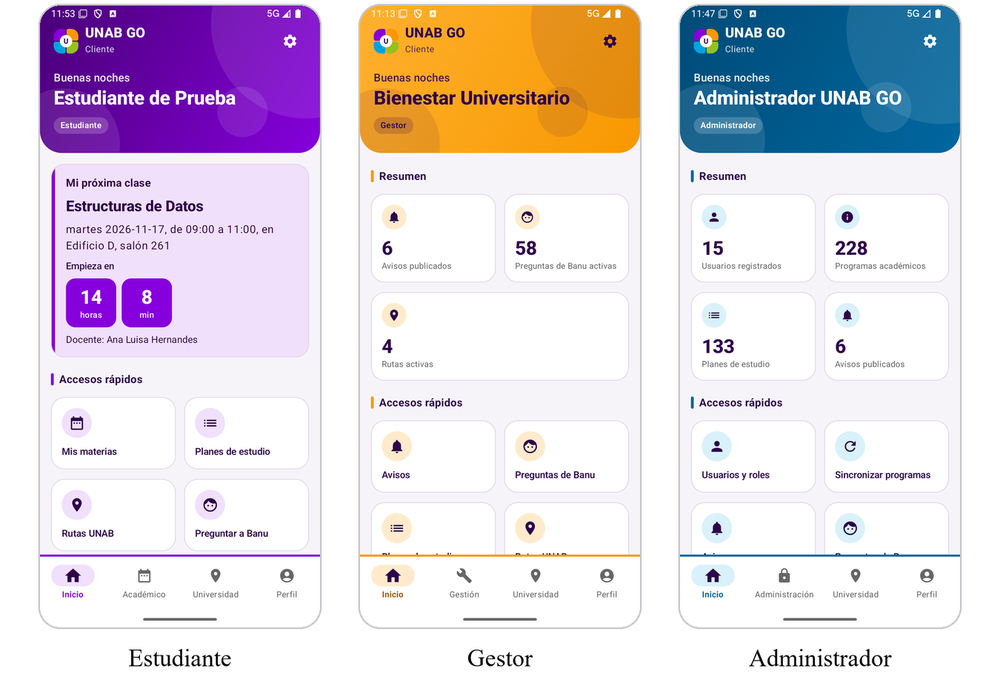
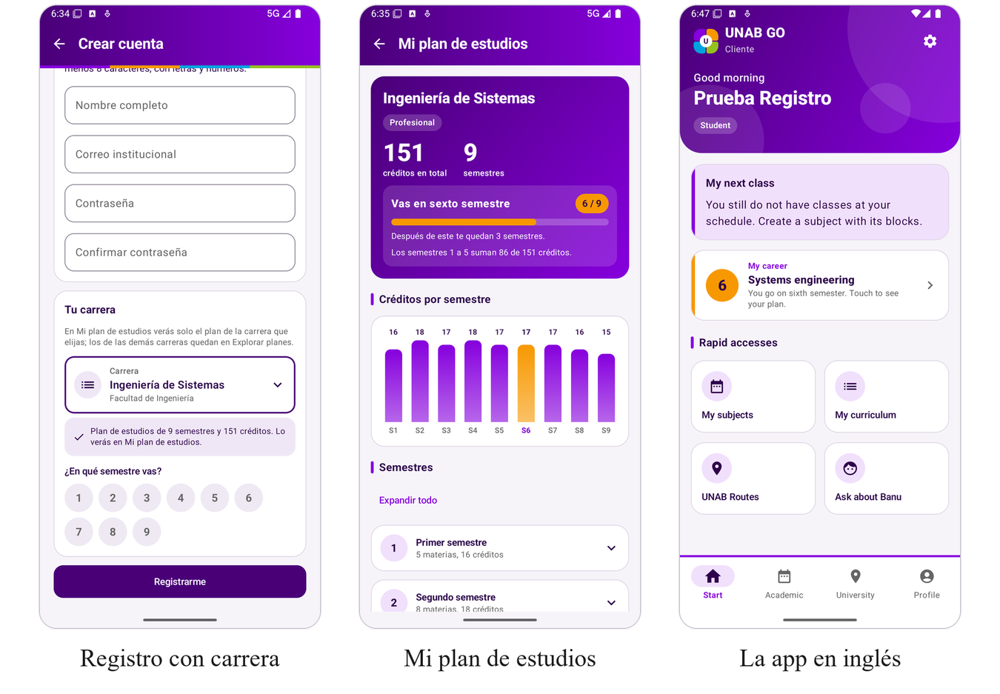

# UNAB GO! Backend y cliente Android

Proyecto final de **Desarrollo y Arquitectura Backend** (Universidad Autónoma de Bucaramanga). UNAB GO! reúne los
servicios académicos, institucionales y de bienestar de la UNAB: horario y notas del estudiante, avisos, Rutas UNAB en
vivo, programas, profesores, planes de estudio oficiales y Banu, el asistente de preguntas frecuentes.

El backend es una API REST en **Kotlin con Ktor** (tecnología equivalente a Laravel, propuesta en la Entrega 1) y el
frontend es una app **Android nativa en Kotlin** con Jetpack Compose que consume esa API.



## En cifras

| Backend | Cliente Android |
|---|---|
| 41 endpoints REST bajo `/api/v1` | Flujos completos de los 3 roles con colores institucionales por rol |
| 19 tablas y 7 migraciones Flyway | Registro con lista de carreras y semestre |
| 3 roles con Gates y 5 Policies | Mi plan de estudios con el semestre actual resaltado |
| 6 servicios externos encapsulados | Traductor en el teléfono (ML Kit) a 4 idiomas, por wifi |
| 133 planes de estudio oficiales (618 semestres, 3951 cursos) | Idioma guardado en el perfil de cada usuario |
| 114 pruebas automatizadas | 102 pruebas automatizadas |

## Estructura del repositorio

| Ruta | Contenido |
|---|---|
| `unabgo-backend/` | API REST (Ktor, Exposed, Flyway): código, pruebas, migraciones, [README](unabgo-backend/README.md) y [referencia de la API](unabgo-backend/docs/API.md) |
| `unabgo-android/` | Cliente Android conectado al backend ([README](unabgo-android/README.md)) |
| `docs/capturas/` | Capturas de la app usadas en este README |

## Requisitos

- **JDK 21** (el proyecto compila a bytecode de Java 21; no funciona con un JDK menor). Comprueba con `java -version`.
- Nada más para el backend: Gradle se descarga solo con el wrapper (`./gradlew`, en Windows `gradlew.bat`).
- Para el cliente: Android Studio (o el Android SDK con la plataforma 36) y un emulador o teléfono con Android 8.0 o superior.
- Opcional: Docker, para usar PostgreSQL en lugar de la base H2 local.

## Inicio rápido del backend

```bash
cd unabgo-backend

# 1. Configuración: copia el archivo de ejemplo (por defecto usa H2 en ./data, no hay que cambiar nada)
cp .env.example .env

# 2. Migraciones y seeders (equivale a php artisan migrate:fresh --seed)
./gradlew migrateFresh

# 3. Iniciar el servidor en http://localhost:8080
./gradlew run

# 4. Comprobar que responde
curl http://localhost:8080/api/v1/health

# 5. Suite de pruebas (H2 en memoria, migraciones en cada prueba, APIs externas simuladas)
./gradlew test --no-daemon
```

En Windows (PowerShell) los mismos pasos son `copy .env.example .env`, `.\gradlew.bat migrateFresh` y `.\gradlew.bat run`.
Tareas de consola: `./gradlew migrate` (solo migraciones), `./gradlew migrateFresh` (borra, migra y siembra) y
`./gradlew dbSeed` (solo seeders).

## Cuentas de prueba

Las crea `./gradlew migrateFresh`. Son cuentas de demostración para desarrollo y la sustentación.

| Rol | Usuario (correo) | Contraseña | Qué probar |
|---|---|---|---|
| Estudiante | `demo.estudiante@unab.edu.co` | `Unab2026*` | Próxima clase, materias y notas, Mi plan de estudios (Ingeniería de Sistemas), Banu, rutas favoritas |
| Gestor (Bienestar) | `demo.bienestar@unab.edu.co` | `Unab2026*` | Resumen, avisos, preguntas de Banu y rutas (app en naranja) |
| Gestor (Transporte) | `demo.transporte@unab.edu.co` | `Unab2026*` | Resumen, rutas y buses en vivo, avisos |
| Administrador | `demo.admin@unab.edu.co` | `Unab2026*` | Usuarios y cambio de rol, sincronizar programas (app en azul) |

`migrateFresh` crea además 11 estudiantes de prueba con datos generados por las factories. En la app, la sección
*Cuentas de prueba* de la pantalla de inicio de sesión llena el formulario con un toque. También se puede crear una
cuenta nueva con cualquier correo `@unab.edu.co`, eligiendo la carrera y el semestre.

```bash
curl -X POST http://localhost:8080/api/v1/auth/login -H "Content-Type: application/json" \
  -d '{"email":"demo.estudiante@unab.edu.co","password":"Unab2026*","device_name":"curl"}'
curl http://localhost:8080/api/v1/schedule/next -H "Authorization: Bearer {token}"
```

Las claves de los servicios externos (GPS, Firebase, IA de Banu, WordPress) son opcionales y van solo en `.env`, que
no se sube al repositorio. `.env.example` solo trae valores vacíos o de ejemplo. Sin ellas, el endpoint que depende
del servicio responde 503 y el resto de la API funciona.

## Cliente Android

```bash
cd unabgo-android
./gradlew :app:assembleDebug        # APK en app/build/outputs/apk/debug/app-debug.apk
./gradlew :app:testDebugUnitTest    # 102 pruebas
```

También se puede abrir la carpeta `unabgo-android` en Android Studio y pulsar Run. El servidor escucha en el puerto
**8080** (variable `APP_PORT`):

- Emulador: no hay que cambiar nada, la app usa `http://10.0.2.2:8080` (el computador visto desde el emulador).
- Teléfono físico: misma red Wi-Fi que el computador; en el engranaje de la pantalla de inicio de sesión se escribe
  `http://<IP del computador>:8080` (la IPv4 que muestra `ipconfig`) y se pulsa *Probar conexión*. El firewall de
  Windows debe permitir el puerto 8080.
- La versión debug permite HTTP sin cifrar; la versión release solo acepta `https`.



## Pruebas

- **Backend: 114 pruebas** (JUnit y Ktor `testApplication`) que cubren los 41 endpoints con su caso exitoso y los
  errores principales (400, 401, 403, 404, 409, 429 y 503). Usan H2 en memoria con las migraciones ejecutadas en cada
  prueba y `MockEngine` de Ktor para simular todos los servicios externos. El reporte queda en
  `unabgo-backend/build/reports/tests/test/index.html`.
- **Cliente: 102 pruebas** JVM: ViewModels con repositorios falsos, cliente HTTP contra MockWebServer, sesión, paleta
  por rol, registro con carrera, Mi plan de estudios y el traductor (caché, espera de wifi, idioma por usuario).

## De Laravel a Ktor (equivalencias de la Entrega 1)

| Laravel | Este proyecto |
|---|---|
| Eloquent, `$fillable`, relaciones | Exposed DAO; la asignación masiva la limitan las clases de solicitud |
| Migraciones | Migraciones SQL de Flyway (`db/migration`) |
| Factories y `DatabaseSeeder` | Factories con Datafaker y `DatabaseSeeder` |
| `migrate:fresh --seed` | `./gradlew migrateFresh` |
| Sanctum | Tokens propios `id.secreto`, solo se guarda su huella SHA-256 |
| Gates y Policies | `Gate`, `Ability` y las policies de `auth/Policies.kt` |
| FormRequest | Clases de solicitud con validación y mensajes en español (`http/requests`) |
| API Resources | Resources con respuesta `{data, meta}` y errores `{error, code, fields}` |
| `routes/api.php` | `http/routes/ApiRoutes.kt` |
| `Http::fake()` | `MockEngine` de Ktor |
| SQLite en memoria | H2 en memoria |
| `.env` y `config/services.php` | `.env` y `AppConfig.kt` |
| Exención de CSRF en webhooks | Ktor no trae CSRF; el webhook se protege con firma HMAC-SHA256 |

## Documentación

- [Referencia de la API](unabgo-backend/docs/API.md): endpoints, validaciones, ejemplos y errores.
- [README del backend](unabgo-backend/README.md): modelos, integraciones externas, servicios y estructura del código.
- [README del cliente Android](unabgo-android/README.md): pantallas, roles, carrera propia, traductor y conexión.
